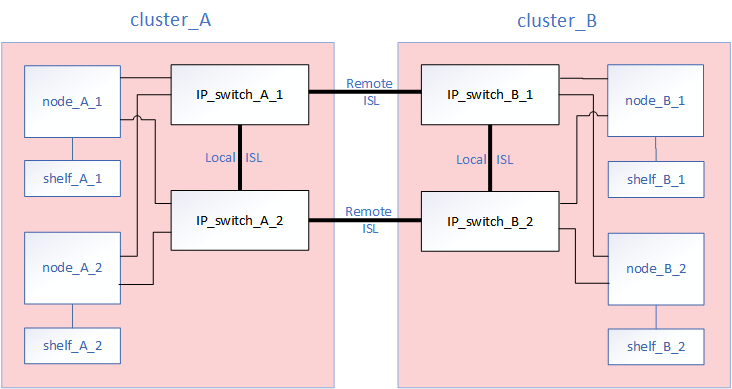
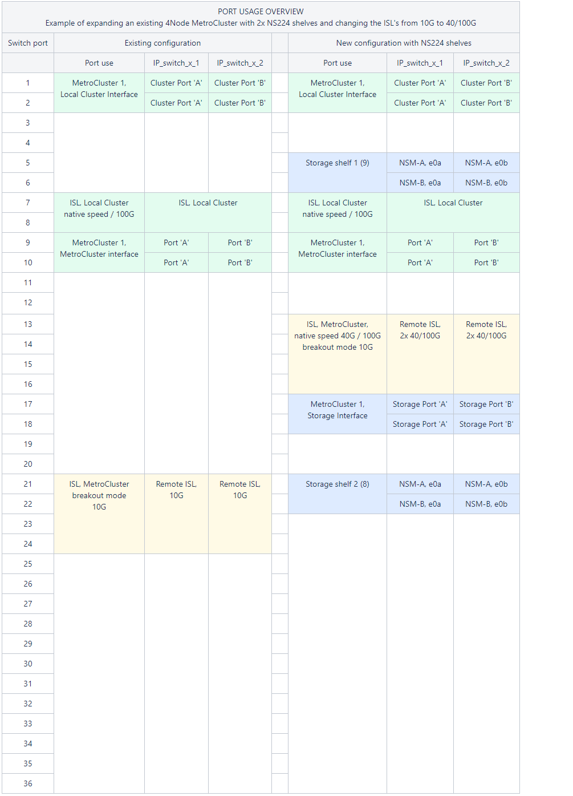

= Remplacer ou réaffecter un commutateur dans une configuration IP MetroCluster
:allow-uri-read: 
:icons: font
:imagesdir: ../media/

[role="lead"]
Vous devrez peut-être remplacer un commutateur défectueux, mettre à niveau ou rétrograder un commutateur, ou modifier l'utilisation des commutateurs IP MetroCluster existants.

CAUTION: Si vous devez effectuer un remplacement de commutateur sur les plateformes AFF A220, AFF A250 ou FAS2750, reportez-vous à link:https://kb.netapp.com/on-prem/ontap/mc/MC-KBs/Cluster_and_HA_communication_issues_during_back-end_switch_replacement["l’article de la Knowledge Base « Cluster and HA communication issues during back-end switch replacement »"^].

.Description de la tâche
Cette procédure s'applique lorsque vous utilisez des commutateurs validés par NetApp. Si vous utilisez des switchs conformes à MetroCluster, reportez-vous au fournisseur du commutateur.

link:enable-console-logging-before-maintenance.html["Activer la journalisation de la console"] avant d'effectuer cette tâche.

[NOTE]
====
Les débits de liaison mixtes ne sont pas pris en charge sur les plateformes utilisant une carte d'interface réseau X60134A. Pour vérifier si votre plateforme est concernée, consultez la https://hwu.netapp.com/["Hardware Universe"^].

Si vous remplacez un commutateur utilisant des ports 25G par un nouveau commutateur utilisant des ports 100G sur une plateforme concernée (par exemple, en remplaçant un commutateur BES-53248 par un commutateur Cisco 9336C sur une plateforme AFF A50), reportez-vous à link:https://kb.netapp.com/on-prem/ontap/mc/MC-KBs/100G_link_not_coming_online_during_MetroCluster_back-end_switch_replacement?caseId=2010523490["l'article de la base de connaissances « 100G link not coming online during MetroCluster back-end switch replacement »"^].

====
Cette procédure prend en charge les conversions suivantes :

* Modification du fournisseur, du type ou des deux commutateurs. Le nouveau commutateur peut être identique à l'ancien commutateur en cas de défaillance d'un commutateur ou vous pouvez modifier le type de commutateur (mettre à niveau ou rétrograder le commutateur).
+
Par exemple, pour étendre une configuration IP MetroCluster d'une configuration unique à quatre nœuds à l'aide de contrôleurs AFF A400 et de commutateurs BES-53248 à une configuration à huit nœuds à l'aide de contrôleurs AFF A400, vous devez remplacer les commutateurs par un type pris en charge pour la configuration, car les commutateurs BES-53248 ne sont pas pris en charge dans la nouvelle configuration.

+
Si vous souhaitez remplacer un commutateur défectueux par le même type de commutateur, vous devez remplacer uniquement le commutateur défectueux. Si vous souhaitez mettre à niveau ou rétrograder un commutateur, vous devez régler deux commutateurs situés sur le même réseau. Deux commutateurs se trouvent sur le même réseau lorsqu'ils sont connectés via une liaison ISL et non sur le même site. Par exemple, le réseau 1 inclut IP_switch_A_1 et IP_switch_B_1, et le réseau 2 inclut IP_switch_A_2 et IP_switch_B_2, comme indiqué dans le schéma ci-dessous :

+

+

NOTE: Si vous remplacez un switch ou effectuez une mise à niveau vers d'autres switchs, vous pouvez préconfigurer les switchs en installant le firmware du switch et le fichier RCF.

* Convertissez une configuration IP MetroCluster en configuration IP MetroCluster à l'aide de commutateurs MetroCluster de stockage partagé.
+
Par exemple, si vous disposez d'une configuration IP MetroCluster standard avec les contrôleurs AFF A700 et que vous souhaitez reconfigurer le MetroCluster pour connecter les tiroirs NS224 aux mêmes switchs.

+
[NOTE]
====
** Si vous ajoutez ou supprimez des tiroirs dans une configuration MetroCluster IP à l'aide de commutateurs MetroCluster IP de stockage partagé, suivez les étapes de la section link:https://docs.netapp.com/us-en/ontap-metrocluster/maintain/task_add_shelves_using_shared_storage.html["Ajout de tiroirs à une adresse IP MetroCluster à l'aide de commutateurs MetroCluster de stockage partagé"]
** Votre configuration IP MetroCluster peut déjà se connecter directement aux tiroirs NS224 ou aux commutateurs de stockage dédiés.

====

[[port_usage_worksheet]]
.Fiche technique d'utilisation des ports
Voici un exemple de feuille de calcul pour la conversion d'une configuration MetroCluster IP en une configuration de stockage partagé qui connecte deux tiroirs NS224 à l'aide des commutateurs existants.

Définitions de feuille de calcul :

* Configuration existante : câblage de la configuration MetroCluster existante.
* Nouvelle configuration avec les tiroirs NS224 : configuration cible dans laquelle les switchs sont partagés entre le stockage et le MetroCluster.

Les champs mis en surbrillance dans cette feuille de calcul indiquent les éléments suivants :

* Vert : vous n'avez pas besoin de changer le câblage.
* Jaune : vous devez déplacer des ports avec une configuration identique ou différente.
* Bleu : ports qui sont de nouvelles connexions.

.Étapes
. [[all_step1]]Vérifiez l'état de santé de la configuration.
+
.. Vérifier que la MetroCluster est configurée et en mode normal sur chaque cluster : `*metrocluster show*`
+
[listing]
----
cluster_A::> metrocluster show
Cluster                   Entry Name          State
------------------------- ------------------- -----------
 Local: cluster_A         Configuration state configured
                          Mode                normal
                          AUSO Failure Domain auso-on-cluster-disaster
Remote: cluster_B         Configuration state configured
                          Mode                normal
                          AUSO Failure Domain auso-on-cluster-disaster
----
.. Vérifier que la mise en miroir est activée sur chaque nœud : `*metrocluster node show*`
+
[listing]
----
cluster_A::> metrocluster node show
DR                           Configuration  DR
Group Cluster Node           State          Mirroring Mode
----- ------- -------------- -------------- --------- --------------------
1     cluster_A
              node_A_1       configured     enabled   normal
      cluster_B
              node_B_1       configured     enabled   normal
2 entries were displayed.
----
.. Vérifier que les composants MetroCluster sont sains : `*metrocluster check run*`
+
[listing]
----
cluster_A::> metrocluster check run

Last Checked On: 10/1/2014 16:03:37

Component           Result
------------------- ---------
nodes               ok
lifs                ok
config-replication  ok
aggregates          ok
4 entries were displayed.

Command completed. Use the "metrocluster check show -instance" command or sub-commands in "metrocluster check" directory for detailed results.
To check if the nodes are ready to do a switchover or switchback operation, run "metrocluster switchover -simulate" or "metrocluster switchback -simulate", respectively.
----
.. Vérifier qu'il n'y a pas d'alerte de santé : `*system health alert show*`

. Si votre configuration IP MetroCluster comporte des baies NVMe connectées aux commutateurs IP MetroCluster, exécutez les commandes suivantes pour vérifier l'état des baies.
+
.. Afficher l'état du tiroir :
+
`storage shelf show`

+
.Afficher un exemple
[%collapsible]
====
[listing]
----
cluster_A::> storage shelf show
                                                        Module  Operational
       Shelf Name Shelf ID Serial Number   Model        Type    Status
----------------- -------- --------------- ------------ ------- -----------
              1.0        0 952123456789    NS224NSM100  NSM100  Normal
              1.2        0 952987654321    NS224NSM100  NSM100  Normal
cluster_A::>
----
====
.. Afficher la connectivité des baies NVMe connectées au commutateur :
+
`storage shelf show -shelf <shelf_name> -connectivity`

+
.Afficher un exemple
[%collapsible]
====
[listing]
----
cluster_A::> storage shelf show -shelf 1.0 -connectivity
            Shelf Name: 1.0
             Stack ID: 1
             Shelf ID: 0
            Shelf UID: 00:00:00:00:00:00:00:00
        Serial Number: 952123456789
          Module Type: NSM100
                Model: NS224NSM100
         Shelf Vendor: NETAPP
           Disk Count: 24
      Connection Type: NVMe
          Shelf State: Online
               Status: Normal
Paths:

Controller         Initiator Initiator Side Switch Port Target Side Switch Port    Target Port        TPGN
------------------ --------- -------------------------- -------------------------- ------------------ ------
cluster_A-01       0x        -                          0x                         05000005abff0000   67
cluster_A-02       0x        -                          0x                         030f0005abff0000   44

cluster_A::>
----
====
.. Si nécessaire, collectez les noms des périphériques distants (commutateurs MetroCluster) :
+
.Afficher un exemple
[%collapsible]
====
[listing]
----
cluster_A::> storage shelf port show -fields remote-device

shelf id remote-device
----- -- -------------
1.0   0  IP_switch_A_1
1.0   1  IP_switch_B_1
1.0   2  IP_switch_A_2
1.0   3  IP_switch_B_2
4 entries were displayed
----
====
.. Affichez la connectivité des ports de tiroir pour les tiroirs NVMe connectés au commutateur :
+
`storage shelf port show -remote-device <switch name>`

+
.Afficher un exemple
[%collapsible]
====
[listing]
----
cluster_A::> storage shelf port show -remote-device IP_switch_A_1

Shelf ID Module State        Internal?
----- -- ------ ------------ ---------
1.0
       1 A      connected    false
       3 B      connected    false
1.2
       1 A      connected    false
       3 B      connected    false
4 entries were displayed.

cluster_A::>
----
====

. Configurer le nouveau commutateur avant l'installation.
+
Si vous réutilisez des commutateurs existants, passez à <<existing_disconnect,l'étape consistant à déconnecter les connexions de l'ancien commutateur>>.

+

NOTE: Si vous mettez à niveau ou déclariez les commutateurs, vous devez configurer tous les commutateurs du réseau.

+
Suivez les étapes pour votre fournisseur de commutateur :

+
Assurez-vous d'appliquer le fichier RCF approprié pour le commutateur _A_1, _A_2, _B_1 ou _B_2. Si le nouveau switch est identique à l'ancien switch, vous devez appliquer le même fichier RCF.

+
Si vous mettez à niveau ou déclasser un commutateur, appliquez le fichier RCF le plus récent pris en charge pour le nouveau commutateur.

+
** link:../install-ip/task_switch_config_broadcom.html["Configurez les commutateurs IP Broadcom"]
** link:../install-ip/task_switch_config_cisco.html["Configuration des commutateurs IP Cisco"]
** link:../install-ip/task_switch_config_nvidia.html["Configurez les commutateurs IP NVIDIA"]

. link:../install-ip/switch-move-cluster-lifs.html["Déplacez les LIF du cluster"].
+

NOTE: Vous devez mettre à jour les commutateurs dans l'ordre suivant : Switch_A_1, Switch_B_1, Switch_A_2, Switch_B_2. Vous devez répéter les étapes pour déplacer les LIF du cluster sur le deuxième fabric (Switch_A_2, Switch_B_2) après avoir configuré les commutateurs dans le premier fabric (Switch_A_1, Switch_B_1). Reportez-vous à link:../install-ip/task_install_and_cable_the_mcc_components.html["Découvrez comment configurer les commutateurs IP MetroCluster"].

. [[existing_disconnect]]Déconnectez les connexions de l’ancien commutateur.
+

NOTE: Vous ne déconnectez que les connexions qui n'utilisent pas le même port dans les anciennes et les nouvelles configurations. Si vous utilisez de nouveaux commutateurs, vous devez déconnecter toutes les connexions.

+
Déposer les connexions dans l'ordre suivant :

+
.. Déconnectez les interfaces locales du cluster
.. Déconnectez les liens ISL locaux du cluster
.. Déconnectez les interfaces IP MetroCluster
.. Déconnectez les liens ISL MetroCluster
+
Dans l'exemple <<port_usage_worksheet>>, les commutateurs ne changent pas. Les liens ISL de MetroCluster sont déplacés et doivent être déconnectés. Vous n'avez pas besoin de déconnecter les connexions marquées en vert sur la feuille de travail.

. Si vous utilisez de nouveaux commutateurs, mettez l'ancien commutateur hors tension, retirez les câbles et retirez physiquement l'ancien commutateur.
+
Si vous réutilisez des commutateurs existants, passez à <<existing_configure,l'étape de configuration des commutateurs existants>>.

+

NOTE: Ne câblez *pas* les nouveaux commutateurs à l'exception de l'interface de gestion (le cas échéant).

. [[existing_configure]]Configurez les commutateurs existants.
+
Si vous avez déjà préconfiguré les commutateurs, vous pouvez ignorer cette étape.

+
Pour configurer les switchs existants, suivez la procédure d'installation et de mise à niveau des fichiers du micrologiciel et des fichiers RCF :

+
** link:https://docs.netapp.com/us-en/ontap-metrocluster/maintain/task_upgrade_firmware_on_mcc_ip_switches.html["Mise à niveau du micrologiciel sur les commutateurs IP MetroCluster"]
** link:https://docs.netapp.com/us-en/ontap-metrocluster/maintain/task_upgrade_rcf_files_on_mcc_ip_switches.html["Mettre à niveau les fichiers RCF sur les commutateurs IP MetroCluster"]

. Câbler les commutateurs.
+
Vous pouvez suivre les étapes dans link:../install-ip/using_rcf_generator.html["Branchez les câbles des commutateurs IP MetroCluster"].

+
Câblez les interrupteurs dans l'ordre suivant (si nécessaire) :

+
.. Reliez les liens ISL au site distant.
.. Reliez les interfaces IP MetroCluster.
.. Reliez les interfaces locales du cluster.
+
[NOTE]
====
*** Les ports utilisés peuvent être différents de ceux de l'ancien commutateur si le type de commutateur est différent. Si vous effectuez une mise à niveau ou une rétrogradation des commutateurs, procédez à *PAS* de câble reliant les liens ISL locaux. Connectez les liens ISL locaux uniquement si vous mettez à niveau ou rétrogradiez les switchs du second réseau, et que les deux commutateurs d'un site présentent le même type et le même câblage.

====

. Mettez le ou les commutateurs sous tension.
+
Si le nouveau commutateur est identique, mettez-le sous tension. Si vous effectuez une mise à niveau ou une rétrogradation des commutateurs, mettez les deux commutateurs sous tension.

. Répétez les étapes précédentes pour la seconde structure (Switch_A_2 et Switch_B_2) après avoir mis à jour la première structure (Switch_A_1 et Switch_B_1).
+

NOTE: Si vous remplacez un commutateur défectueux par un commutateur du même type, il vous suffit de mettre à jour le commutateur défectueux et vous n’avez pas besoin de répéter les étapes pour le second fabric.

. Finalisez le câblage local du cluster.
+
.. Si les interfaces de cluster locales sont connectées à un commutateur :
+
... Reliez les liens ISL du cluster local.

.. Si les interfaces de cluster locales sont *non* connectées à un commutateur :
+
... Utilisez la link:https://docs.netapp.com/us-en/ontap-systems-switches/switch-bes-53248/migrate-to-2n-switched.html["Migrer vers un environnement de cluster NetApp commuté"^]procédure pour convertir un cluster sans commutateur en un cluster commuté. Utilisez les ports indiqués dans link:https://docs.netapp.com/us-en/ontap-metrocluster/install-ip/using_rcf_generator.html["Installation et configuration de MetroCluster IP"] ou les fichiers de câblage RCF pour connecter l’interface du cluster local.

. Vérifiez que la configuration MetroCluster fonctionne correctement en répétant cette procédure <<all_step1,Étape 1>>.
. Rétablissez toutes les LIF de cluster sur leur port d'attache.
+

CAUTION: Ne rétablissez pas les LIF du cluster sur leurs ports d'attache tant que vous n'avez pas terminé les étapes précédentes pour tous les commutateurs nécessitant une mise à jour.

+
.. Modifier toutes les LIFs de cluster pour réactiver auto-revert :
+
[source, cli]
----
network interface modify -vserver <vserver_name> -lif <lif_name> -auto-revert true
----
.. Rétablissez manuellement sur leur port d'attache tous les LIF de cluster qui ne se trouvent pas actuellement sur leur port d'attache :
+
`network interface revert -vserver Cluster -lif *`

. Vous pouvez également déplacer les tiroirs NS224.
+
Si vous reconfigurez une configuration IP MetroCluster qui ne connecte pas les tiroirs NS224 aux commutateurs IP MetroCluster, suivez la procédure appropriée pour ajouter ou déplacer les tiroirs NS224 :

+
** link:https://docs.netapp.com/us-en/ontap-metrocluster/maintain/task_add_shelves_using_shared_storage.html["Ajout de tiroirs à une adresse IP MetroCluster à l'aide de commutateurs MetroCluster de stockage partagé"]
** link:https://docs.netapp.com/us-en/ontap-systems-switches/switch-cisco-9336c-fx2-shared/migrate-from-switchless-cluster-dat-storage.html["Migrez depuis un cluster sans commutateur avec du stockage DAS"^]
** link:https://docs.netapp.com/us-en/ontap-systems-switches/switch-cisco-9336c-fx2-shared/migrate-from-switchless-configuration-sat-storage.html["Migrer d'une configuration sans commutateur vers un système de stockage FAS par commutateur en réutilisant les commutateurs de stockage"^]

.Une fois que vous avez terminé
link:../install-ip/task-configure-log-collection-mccip.html["Configurer la collecte de journaux sur un commutateur IP MetroCluster"]
